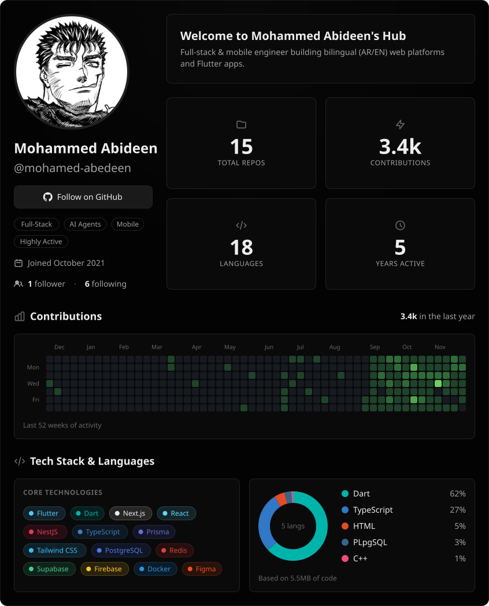

<!-- The card is drawn by hub/generate.py and refreshed daily by .github/workflows/hub.yml. Edit hub/config.json to change it. -->

## Hi, I'm Mohammed 👋

I design and ship bilingual, Arabic-first (RTL) products end to end, with **Next.js** and **NestJS** on the web and **Flutter** on mobile. I graduated in Information Technology (Mobile Computing) from the University of Tripoli, and I work agent-first with **Claude Code** and the **Model Context Protocol (MCP)**.

### 💼 Work

- **Automobility** (remote, 2026 – present): full-stack software engineer building enterprise web platforms in TypeScript monorepos with **NestJS**, **Next.js**, **PostgreSQL**, **Redis** and **Docker**.

### 🛠️ Things I've built

- **[DevFlow](https://github.com/mohamed-abedeen/devflow)**: a self-hosted, GitHub-integrated project manager for dev teams, built with Next.js 14, NestJS 10, Prisma and PostgreSQL.
- **[UOT Exam Print Booking](https://github.com/mohamed-abedeen/UOT_Exam_Print_Booking)**: a University of Tripoli project: an Arabic-only, RTL booking system where each college's exam office reserves time at the print centre, with machine scheduling by job size, stock and hand-over tracking, and three roles (college, operator, admin). Built with **Next.js**, **TypeScript**, **PostgreSQL**, **Drizzle** and **Docker Compose**. No exam file is ever uploaded or stored.
- **[UOT ID System](https://github.com/mohamed-abedeen/UOT_ID_Releases)**: a University of Tripoli project: an employee ID system. Installers are published in the releases repo; the source code is private.
- **[My Gym Bro](https://github.com/mohamed-abedeen/my_gym_bro)**: a Flutter fitness tracker with an offline-first local database, Supabase sync and in-app subscriptions.
- **[Yaqdah](https://github.com/mohamed-abedeen/yaqdah_app_project)**: a Flutter app that spots driver drowsiness with on-device face detection, points you to nearby places to rest and can text your location to an emergency contact.

### 🧰 Tech I work with

**Mobile** · Flutter, Dart, Riverpod, Drift, Firebase, Kotlin  
**Web** · Next.js, React, TypeScript, Tailwind CSS, Radix UI, shadcn/ui  
**Backend** · NestJS, Prisma, Socket.io, Supabase  
**Data** · PostgreSQL, Redis, SQLite, MySQL, MongoDB  
**AI** · MCP servers, Claude Code, Gemini API  
**Tools** · Docker, CI/CD, Turborepo, Figma

  

Card design inspired by <a href="https://github.com/whoisyurii/checkmygit">CheckMyGit</a>. <a href="https://checkmygit.com/mohamed-abedeen">See the interactive version</a>.
